# NetScaler tripwire and post-compromise analysis

A management-host Bash runner and a read-only inventory collector for Citrix NetScaler / ADC appliances. It works as a tripwire: it keeps a trusted baseline of each appliance on the management host and reports what changed, together with generic checks for the techniques attackers have used on NetScaler (webshells in web-served trees, httpd reconfiguration, setuid shells, runtime changes to the root filesystem, persistence, log poisoning). Known indicators of compromise (IOCs) are an optional extra layer, kept in a separate file and reported in their own section (contributions welcome).

Now that all that's been said, I did start on this project before the advent of useful AI when we had the first CitrixBleed. That version wasn't very robust so I didn't share. This time I had help from Codex and Claude, and it appears to do what envisioned this "tripwire for Netscaler" would look like. So, I'm the architect, someone else wrote the code and it looks legit. If it causes catastrophic downtime, YOU ARE ON YOUR OWN. You have been warned. I would also warn against continued use of NetScaler, given the behind-times status of so much on this platform.

## What it looks like



I realise that this looks pretty awful, since it doesn't record the scrollback where I show that it has given an alert on a `chmod +s /bin/sh` and running `python -m http.server`, but well, it does. I guess you will have to download the `.svg` file and see for yourself.

## Files

- `ns-drifter.sh` — run from a trusted Linux, macOS, or other Bash management host.
- `ns-inventory.sh` — the collector. By default the runner streams it to the ADC on every run; it can also be installed on each ADC (`export COLLECT_MODE=installed`), see below.
- `allowlist.default` — suppressions for stock items observed on a NetScaler 14.1 VPX.
- `iocs.conf` — optional known indicators (paths, names, hashes, IPs, accounts, ports, content and log patterns) with sources.

The baseline and reports stay on the management host. `ns-drifter.sh check` does not modify the saved baseline. Protect the local state directory and back it up securely.

## Requirements

- Bash 4.2+ on the management host, plus `ssh`, `gzip`, `base64` and `od` for stream mode.
- SSH access to each ADC as an account permitted to run `shell` commands (commonly the user `nsroot`).
- On the ADC: `sh`, `ps`, `find`, `perl` (with `Digest::SHA`, standard on NetScaler), `sockstat`, and for stream mode `openssl` and `gunzip`. NetScaler images ship without `stat(1)` and `readlink(1)`, so file metadata and hashes come from a single `perl` process; without `perl` only processes, sockets and logs are collected (a `NO_PERL` warning is emitted).
- NetScaler 14.1's `/bin/sh` segfaults while parsing a top-level pipeline containing a compound command (e.g. `cmd | while ...; done`), from a file or stdin, and leaves a core file in `/var/core`. The collector keeps such pipelines inside function bodies; preserve that when editing it, and check changes on an ADC with `sh -n` (IMPORTANT).

## Quick start: nothing is left behind on the appliance

This is the default (stream mode). The collector travels inside the SSH command on every run and is decoded in memory on the ADC; nothing is copied to or written on the appliance, and the baseline and reports stay on the management host.

```sh
export SSH_OPTS='-o BatchMode=yes'      # keys, ports and jump hosts can live in ~/.ssh/config

./ns-drifter.sh baseline adc01          # once, from a known-good state
./ns-drifter.sh check adc01             # on every subsequent run
```

If the collector was installed earlier (see below), remove it; stream mode does not use it:

```sh
ssh nsroot@adc01 'shell rm -f /nsconfig/scripts/ns-inventory.sh'
```

For scheduled runs, e.g. in a crontab on the management host:

```cron
0 * * * * cd /opt/nsdrifter && SSH_OPTS='-o BatchMode=yes' ./ns-drifter.sh -nocolour check adc01 > "$HOME/nsdrifter-$(date +\%Y\%m\%d-\%H\%M).txt" 2>&1
```

### Appliance footprint

What a run does leave behind on the ADC, in either mode:

- **Configuration:** none. The collector only reads files, process and socket state, and logs.
- **Logs:** the SSH login (`/var/log/auth.log`, and a `login` line in the `/var/log/ns.log` CLI audit). Observed on NetScaler 14.1-73.33: the CLI audit records `shell` commands only up to about 8,450 characters, cut to roughly 800 characters in the log line; longer commands still run but only the login is logged. The streamed command is about 10.6 KB, so a stream-mode run currently leaves only the login lines; an installed-mode run logs `shell <REMOTE_PATH>`. Commands passed non-interactively (`ssh adc 'shell …'`) are not added to the CLI history file (`/var/nstmp/<user>/.nscli_history`), which holds a fixed number of entries from interactive sessions. While a run is in progress its command line, payload included, is visible in the process list.
- **Access times:** reading and hashing files updates their access times, because NetScaler mounts nothing `noatime`. Acquire forensic images first if access times may matter to an investigation.
- **Installed mode only:** the collector file itself at `REMOTE_PATH`.

Files larger than 100 MiB are not hashed (`MAX_HASH_SIZE`), to limit appliance load.

## Collection modes

**Stream** (default): nothing is installed. On each run the runner gzips and base64-encodes the local collector into the SSH command line (about 10 KB), and the ADC decodes it with its own `openssl`/`gunzip` straight into `sh`. The collector can't be left stale or tampered with on the appliance, collector settings set in the runner's environment are passed along, and the content and log patterns from `iocs.conf` are only available in this mode. (If I am wrong here, feel free to call me out.)

Each streamed command starts with `: nsdrifter-<token>`, a random per-host token stored in `<state>/<host>/run-tag`, so the collector can leave the tool's own runs out of the `ns.log` CLI-command check. `ns.log` is readable on the appliance, so someone with shell access could reuse the token to hide commands from that one check; every other check is unaffected.

**Installed** (`COLLECT_MODE=installed`): copy the collector to each ADC once and the runner executes it at `REMOTE_PATH`. Useful where the appliance's CLI rejects long commands; the collector then lives on the appliance, where it can go stale or be altered (changes to it are reported as drift), e.g.:

```sh
scp ns-inventory.sh nsroot@adc01:/nsconfig/scripts/ns-inventory.sh
ssh nsroot@adc01 'shell chmod 700 /nsconfig/scripts/ns-inventory.sh'
```

## Usage

```sh
export SSH_OPTS='-i ~/.ssh/adc_ed25519 -o BatchMode=yes'
./ns-drifter.sh baseline adc01 adc02   # create baselines for two ADC's from a known-good state
./ns-drifter.sh check adc01 adc02      # drift + current-state checks
./ns-drifter.sh hunt adc01             # current-state checks only
./ns-drifter.sh -noiocs check adc01    # generic checks only
./ns-drifter.sh -nocolour check adc01 > report.txt
./ns-drifter.sh -progress check adc01      # live progress on stderr
```

Findings are prefixed `[!] HIGH`, `[*] WARNING` or `[i] INFO`; `[+]` marks a clean comparison, `[-]` an item listed for review (not counted) and `[x]` an error. Output is coloured when stdout is a terminal; `-nocolour` (or `--no-colour`, `-nocolor`, `--no-color`, or `NO_COLOR=1`) disables it and `--colour` forces it, e.g. for `less -R`.

`-progress` draws a status line on stderr while the appliance is being inventoried: stage, overall percentage, files collected against the host's previous run, and elapsed time. When stderr is not a terminal (e.g. cron) it prints one line per stage instead. The report on stdout is unchanged.

Exit status is `0` for no findings, `1` when findings were reported, and `2` for collection or baseline errors, so it can run from cron or a monitoring job. A full collection on a 14.1 VPX covers about 15,500 files and takes 20–25 seconds (well, on the equipment I have available).

## Local state and options

Host-specific state is stored in `~/.local/state/netscaler-hunt/<host>/` (directory mode 700, files 600): the baselines (`processes`, `files`, `suid`, `conf`, `markers`, `listeners`, `cores`, raw `inventory`), `inventory.latest`, an optional per-host `allowlist`, and in stream mode `run-tag`.

| Variable | Default | Purpose |
|---|---|---|
| `COLLECT_MODE` | `stream` | `stream` or `installed` |
| `SSH_USER` | `nsroot` | SSH login name |
| `SSH_OPTS` | empty | Additional SSH options; whitespace-separated |
| `REMOTE_PATH` | `/nsconfig/scripts/ns-inventory.sh` | Collector location on the ADC (installed mode) |
| `MAX_HASH_SIZE` | `104857600` | Maximum bytes hashed per file |
| `STATE_ROOT` | `~/.local/state/netscaler-hunt` | Local baseline/state directory |
| `ALLOWLIST_DEFAULT` | `./allowlist.default` | Shipped suppression list |
| `IOC_FILE` | `./iocs.conf` | Known-indicator list (`-noiocs` disables it) |

Collector settings (runner environment in stream mode, environment on the ADC in installed mode):

| Variable | Default | Purpose |
|---|---|---|
| `SCAN_ROOTS` | `/nsconfig /flash /bin /sbin /usr/bin /usr/sbin /usr/libexec /usr/local/bin /usr/local/sbin /lib /usr/lib /usr/local/lib /etc /root /netscaler /var /tmp` | Trees inventoried (symlinked roots such as `/nsconfig` are recorded but not followed; its content is under `/flash/nsconfig`) |
| `EXCLUDE_RE` | logs, cores, traces, profiler output, `/var/run`, `/var/db`, `/var/crash`, `/var/python/{lib,include}`, `/var/mastools/logs` | Paths left out of the file inventory and marker scan (not the server-side script sweep) |
| `SWEEP_ROOTS` | the excluded `/var` trees above (the Python library tree is swept for hidden files only) | Excluded trees swept by name, without baselining, for hidden files and executables |
| `SUID_ROOTS` | `/` | Setuid/setgid sweep over all local filesystems |
| `MARKER_ROOTS` | `/var /netscaler/portal /tmp` | Trees whose file contents are searched for webshell primitives |
| `MARKER_RE`, `CONFIG_MARKER_RE` | built in | Content patterns for webshells, and for tampering in `/flash/nsconfig` and `/etc` |
| `POSTBOOT_GRACE` | `900` | Seconds after boot before root-fs changes count |
| `LOG_HUNT` | `1` | Set to `0` to skip log searches |

## What it reports

### Drift (`check`, against the baseline)

- Processes added, removed, or changed in count (keyed on user and command, with current pids). The collector's own processes are excluded (its branch of the process tree and the sshd session processes above it); everything else is reported, including other logged-in sessions and anything started from them. This also holds with SSH connection sharing (`ControlMaster`), where an interactive login and the tool's run share one sshd session on the appliance.
- Files, directories and symlinks added, removed, or changed in type, size, mtime, ownership, mode (including setuid/setgid/sticky), hash or link target, labelled by type. Directories are only reported for type, owner or mode changes (their size and mtime change whenever entries come and go; lasting entries are reported themselves). HIGH for new or changed setuid/setgid files, new or changed files in web roots, new hidden files or directories, new or changed files in the firmware-owned system directories on the root memory disk (`/bin`, `/sbin`, `/lib`, `/libexec`, `/usr`, `/netscaler`), and new files in `/tmp` and `/var/tmp`. Files removed from system directories are WARNING, and a file or directory that becomes world-writable is HIGH. When the ADM agent (`/var/mastools`) upgrades itself, which rewrites about 100 of its files, the changes under its directory are summarised in one `ADM AGENT UPDATED: <old> -> <new>` WARNING with the first paths listed for review; the other checks (world-writable, hidden, setuid, ...) still apply to those files.
- Setuid/setgid files across all local filesystems.
- Listening sockets (TCP listeners and bound UDP sockets), keyed on user, process name, protocol, local address and the listening process's executable path, so worker processes and restarts don't count but a look-alike on the same address (e.g. another `httpd` on `127.0.0.1:81`) does. A new listener is HIGH (bind shell, tunnel, ad-hoc server); one that disappears is INFO. Established connections change constantly and are only listed for review.
- Configuration lines: cron tables, `rc.netscaler`, `nsbefore.sh`/`nsafter.sh`, `rc.conf`, SSH authorized keys (`/nsconfig/ssh`, `/root/.ssh`, `/var/pubkey/<user>/.ssh`), httpd directives (`php_flag` including commented-out ones, `Listen`, `<VirtualHost>`, `DocumentRoot`/`ServerRoot`, `User`/`Group`, `LoadFile`, proxying, `Alias*`, `<Files*>`, handlers, rewrites), FreeBSD `libmap` files (`/etc/libmap.conf`, `/etc/libmap32.conf`, `/usr/local/etc/libmap.d/*`) and `ns.conf` system users, groups, command policies and management access (password hashes redacted). Added lines are HIGH.
- Webshell content markers (HIGH outside, WARNING inside vendor trees).
- Packet-engine core dumps in `/var/core` and kernel crash dumps in `/var/crash` (savecore's `bounds` and `minfree` aside), keyed on path and mtime so a dump overwriting an older one counts. A new dump is HIGH (crashes accompany memory-corruption exploitation); one that disappears is INFO. All current dumps are still listed under the generic checks.

### Generic current-state checks (`check` and `hunt`)

These encode techniques from public reporting on NetScaler exploitation since CVE-2019-19781 (template injection, NOTROBIN), CVE-2023-3519 (CISA AA23-201A, Fox-IT/DIVD), CVE-2025-6543 (NCSC-NL) and CVE-2026-88771/88772, without depending on specific indicators.

- **Web-served trees** (from the appliance's httpd `Alias`/`Directory` configuration): `/var/netscaler/logon`, `/var/netscaler/gui` (also reached as `/netscaler/ns_gui`, a symlink), `/var/netscaler/help`, `/netscaler/portal`, `/var/vpn*`, `/var/ns_gui`. Hidden entries, `.sig` files, scripts in the logon customization folder, XML in `/netscaler/portal/templates` and files in `/var/vpn/bookmark` are reported.
- **Server-side script sweep**: every `.php*`, `.phtml`, `.phar` and `.xhtml` file, plus any extension `httpd.conf` maps to PHP, anywhere under `/var`, `/netscaler/portal`, `/tmp` and `/flash` (regardless of `EXCLUDE_RE`). Stock NetScaler has these only in the admin GUI (`/var/netscaler/gui/admin_ui`), so any other is HIGH.
- **httpd reconfiguration**: `php_flag engine on`, a commented-out `php_flag engine off`, PHP handlers (`AddHandler`/`SetHandler`), non-standard extensions mapped to PHP, `AliasMatch` (none in the stock configuration), aliases routing to hidden files, temp paths, `.sig`/`.php` targets or the logon customization folder, and `<Files>` rules for dot-files.
- **Root filesystem changed after boot**: the NetScaler root filesystem is a memory disk rebuilt at every boot, so a root-fs file whose inode changed (content, mode or owner) more than `POSTBOOT_GRACE` seconds after boot was modified at runtime — this catches e.g. `chmod u+s /bin/sh` even after the bit is removed again. Changes under `/etc` and `/root` are listed for review.
- **Vendor manifest verification**: every file listed in NetScaler's `.signedexe.manifest` files (`/netscaler`, `/var/python`, `/var/perl5`; about 640 files on 14.1) is checked against the SHA-256 recorded there, no baseline needed. A rewritten manifest itself shows up as file drift.
- Setuid/setgid shells and interpreters, and setuid/setgid files in writable or config areas; others are listed for review.
- Executable files, or files in hidden directories, under `/tmp` and `/var/tmp`; executables in hidden directories anywhere; scripts or executables at the top of `/var`; hidden directories; scripts, binaries and executables in `/flash` and `/nsconfig`.
- **Hidden files without a baseline**: hidden regular files in `/etc`, `/var`, `/lib*`, `/usr`, `/bin`, `/sbin`, `/netscaler`, `/flash` and `/nsconfig` (WARNING). Stock ones are in `allowlist.default` by exact path, so a look-alike name next to a stock hidden file is still reported.
- **Excluded trees**: hidden files and executables inside the log, runtime and database trees left out of the inventory (`SWEEP_ROOTS`), found by name each run without baselining their churn (WARNING).
- **World-writable files and directories** (symlinks, sockets and pipes aside): HIGH in web roots, system directories, configuration areas (`/etc`, `/flash`, `/nsconfig`, cron and SSH key directories) and vendor code trees (`/var/python`, `/var/perl5`, `/var/mastools`, `/var/pgsql`), WARNING elsewhere. A world-writable directory is reported once with the number of world-writable entries below it. Temporary trees are world-writable by design; only a missing sticky bit on `/tmp` or `/var/tmp` is reported. A stock 14.1 VPX already has some: the Linux VPN client installers in `/var/netscaler/gui/vpn/scripts/linux`, the online help tree, build scripts in `/netscaler/protobuf`, the ADM agent's upgrade image, `/flash/nsconfig/krb` and `admautoreg.state`, and `/var/tmp` lacks its sticky bit. These are reported deliberately as weaknesses; allowlist them per host once reviewed.
- **Library injection**: shared libraries (`*.so*`) outside library directories, any FreeBSD `libmap` entry (unused on stock NetScaler, HIGH), and `LD_PRELOAD`/`LD_LIBRARY_PATH`/`libmap` in startup scripts and cron entries.
- Webshell primitives in file contents (`passthru(`, `shell_exec(`, `eval(base64_decode…`, ...) outside vendor trees, and tampering strings in `/flash/nsconfig` and `/etc` (`python3 -c`, `httpd.conf`, `apachectl graceful`, Python base64/zlib decoding).
  Each file with a marker is also checked for base64 *string literals* passed to a decoder (PHP `base64_decode`, Python `b64decode`, Perl `decode_base64`), the way webshells hide a payload, as opposed to ordinary code decoding variables. The report shows `embedded base64: <NONE DETECTED>` or the number of literals, the longest one's length and the start of its decoded content. Vendor files (admin GUI, Perl library, ADM agent) are listed for review because they legitimately use these functions; one that decodes a literal is reported as a WARNING (none do on a stock 14.1 VPX from what I can tell, but I don't have much experience with much variety).
- Suspicious cron entries (temp or hidden paths, decode-and-execute, external downloads, IP addresses, jobs as `nobody`) and startup commands in `rc.netscaler`/`nsbefore.sh`/`nsafter.sh`.
- Processes running from temporary or hidden paths (or interpreters running scripts there), and decode-and-execute or reverse-shell command lines.
- Packet capture files (pcap/pcapng) outside the trace directory, packet-engine core dumps, and kernel crash dumps in `/var/crash`.
- Log evidence in current and rotated logs: log poisoning through packet-engine watchdog messages (`ns.log`, `messages`), packet-engine crashes, DTLS exploitation attempts, command injection, base64 PHP payloads and script requests in `httpaccess*`/`httperror*`, suspicious interactive shell commands in `bash.log`, and suspicious CLI `shell` commands and system-user changes in the `ns.log` CLI audit.
- All listeners and sockets are listed for review.

**Not covered: listeners inside the packet engine.** `sockstat` sees sockets of the FreeBSD side only (e.g. the stock `httpd` on `127.0.0.1:81`). Ports served by the packet engine (NSPPE) — vservers, services and IP bindings in the running configuration — are not inventoried, and `ns.conf` drift covers only users, groups, command policies and management access. Comparing the running configuration is planned.

### Known indicators (optional, `iocs.conf`)

Specific file paths and names, webshell hashes, IP addresses, system accounts, listener ports, and content and log strings from CVE-2019-19781, CVE-2023-3519, CVE-2025-6543 and CVE-2026-88771/88772 reporting, each with its source. Matches appear in a separate `KNOWN IOC MATCHES` section. Indicators are campaign- and often victim-specific, so the absence of matches means little; the generic checks above are what the tool relies on. Update the file as new reporting appears, or run with `-noiocs`. Pull requests are welcome but those not referenced with a source will be ignored.

## Allowlist

Findings whose full text (`[LEVEL] message`) matches an extended regular expression in `allowlist.default`, `$STATE_ROOT/allowlist` (all hosts) or `$STATE_ROOT/<host>/allowlist` (one host) are suppressed and counted separately in the summary. Keep entries narrow, anchor the level and finding type and end paths with a space. This so that a suppression cannot hide a different file. Review the shipped list against your own appliances.

## Baseline handling

Create the first baseline from a known-good appliance state, after normal maintenance and configuration changes are complete. Keep a copy of the whole local state directory in a restricted, backed-up location. Do not run `baseline` casually: it replaces the trusted baseline for each named host. Baselines made by older versions lack some components (`suid`, `conf`, `markers`, `listeners`, `cores`, listener executables); `check` skips or narrows those comparisons until `baseline` is re-run. Changing `SCAN_ROOTS` or upgrading the tool also warrants a new baseline. During an investigation, preserve the current baseline and raw inventory before taking further action.

This is a triage and drift-detection aid, not a proof of compromise or a substitute for forensic acquisition. NetScaler releases and appliance configuration differ; expected processes, generated files, and socket listeners vary. Review findings in context and use vendor-supported response and evidence collection procedures.

## License

MIT would be a good fit, I suppose?

## Who

(c) 2026 Tor 'Looks Legit' Houghton and my mates Codex & Claude
